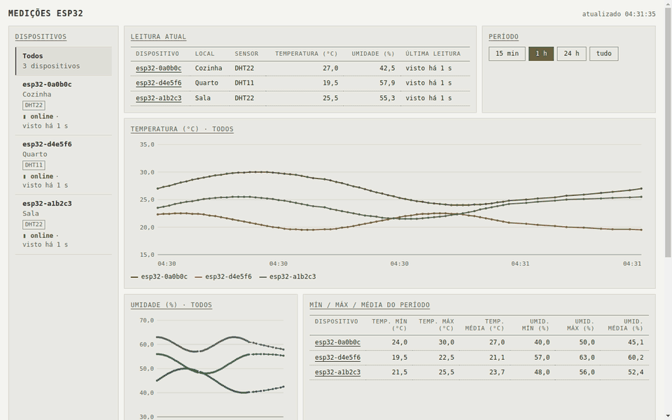
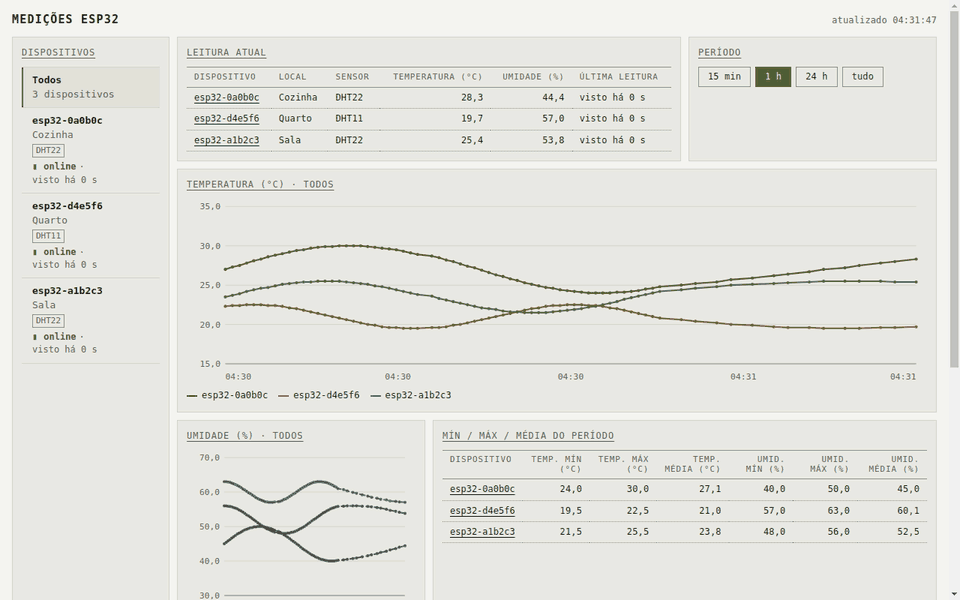
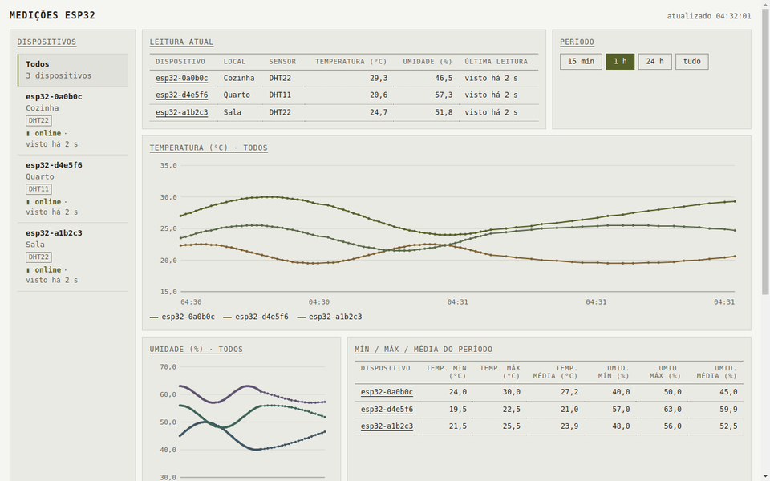
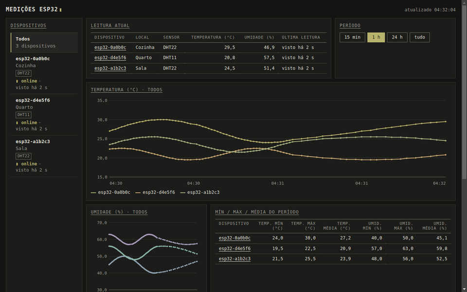
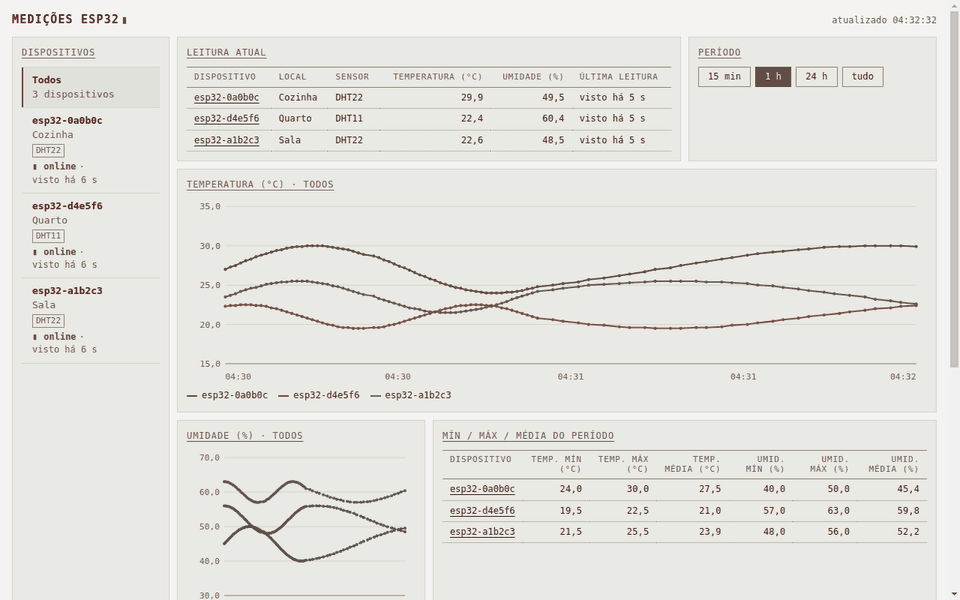

# esp32-pbl-iot

ESP32 reads a DHT sensor and POSTs to a PHP webservice that stores readings in MariaDB, with a live per-device dashboard.




This repository collects the PBLs of the course **Sistemas Embarcados** at IFSP São João da Boa Vista. The `main` branch is **PBL 03**: ESP32 + PHP + MariaDB. The other PBLs are in their own branches, listed in [Other branches](#other-branches).

> The assignments and the base code come from the classes of Prof. Breno Lisi Romano (IFSP São João da Boa Vista). This repository is a teaching implementation and extension of them. It does not claim authorship of the assignments.

## Features

- **Firmware** in Arduino on PlatformIO: reads temperature and humidity every 10 seconds and sends them over Wi-Fi.
- **One ID per board**: taken from the Wi-Fi MAC on a real board, a random ID kept in NVS in simulation, or a fixed override.
- **Webservice** in PHP 8 + Apache: checks the API key, validates `device_id`, and inserts with prepared statements.
- **Storage** in MariaDB 11, started with Docker Compose.
- **Dashboard** with a device list (online/offline), current reading, period filter, min/max/average, SVG charts, readings table, and light and dark themes. It refreshes every 2 seconds.
- **Simulation** setups for Wokwi and Velxio, plus a hidden reset shortcut for test databases.

## How it works

```
DHT11 / DHT22 --GPIO 4--> ESP32 --HTTP POST--> post-esp-data.php --INSERT--> MariaDB (medicoes)
                                                                                  |
browser (dashboard) <--HTML + JSON-- esp-data.php <--SELECT-----------------------+
```

Each POST carries `api_key`, `sensor`, `local_instalado`, `valor1` (temperature, °C), `valor2` (humidity, %), `valor3` (sent as `NULL` today) and `device_id`.

## Quick start

### 1. Backend (Docker)

Requires Docker with Compose v2.

```bash
cp .env.example .env    # then set DB_ROOT_PASSWORD, DB_PASSWORD and API_KEY
docker compose up -d --build
```

Open the dashboard at <http://localhost:8081/esp32mysql/esp-data.php>. It stays empty until the first reading arrives. Compose refuses to start if `DB_ROOT_PASSWORD`, `DB_PASSWORD` or `API_KEY` is missing.

### 2. Firmware

```bash
cp include/secrets.example.h include/secrets.h   # fill in Wi-Fi, SERVER_HOST and API_KEY_VALUE
pio run                 # build
pio run -t upload       # flash
pio device monitor      # serial monitor at 115200 baud
```

On a real board, `SERVER_HOST` must be the LAN address of the machine that runs Docker, for example `http://192.168.0.10:8081`. Do not use `localhost`, which points to the ESP32 itself.

## Real hardware vs simulation

The `SIMULATION` switch in `include/secrets.h` selects the mode. The default `0` is a real board.

| | `SIMULATION 0` (real board) | `SIMULATION 1` (Wokwi / Velxio) |
|---|---|---|
| `device_id` | `esp32-` + last 6 hex digits of the Wi-Fi MAC, e.g. `esp32-a1b2c3` | random place + 2 hex digits, e.g. `esp32-sala-3f`, kept in NVS |
| `local_instalado` | `SENSOR_LOCAL` (default `Sala`) | the random place |
| Sensor | DHT11 | DHT22 (the Wokwi part) |
| Wi-Fi | your network | `Wokwi-GUEST`, no password |

Two options work in both modes:

- `DEVICE_ID_OVERRIDE`: a fixed ID (letters, digits, `_` or `-`, up to 40 characters). It wins over the MAC and the random ID.
- `DEVICE_NAME`: a nickname printed only on the Serial monitor. It is not stored.

To add a real board, flash it with `SIMULATION 0` and set its `SENSOR_LOCAL`. Its MAC gives it a new `device_id`, and it appears in the dashboard after its first reading.

On a real board the random ID stays the same across reboots. Simulators may erase NVS between runs, so a new simulation can get a new ID.

## Simulating

### Wokwi

`diagram.json` holds the circuit: an ESP32 DevKit C v4, a half breadboard and a `wokwi-dht22`. The sensor's data pin is wired to GPIO 4, and power comes through the breadboard rails. The serial monitor is connected. Wokwi has no DHT11 part, so use `SIMULATION 1`.

```bash
pio run                  # wokwi.toml reads .pio/build/esp32dev/firmware.bin
export WOKWI_CLI_TOKEN=<your-token>
wokwi-cli                # from the project root
```

You can also start the simulation from the Wokwi extension in VS Code.

Wokwi runs in the cloud and cannot reach `localhost` or your LAN directly. Use the **Wokwi Private IoT Gateway**, which runs on your computer and lets the simulated ESP32 reach your services. Enable it in the Wokwi VS Code extension (press `F1` and choose *Enable Private Wokwi IoT Gateway*). Inside the simulator, your computer is `host.wokwi.internal`, so set:

```c
#define SERVER_HOST "http://host.wokwi.internal:8081"
```

Without a reachable host, the serial output shows `Erro na requisicao HTTP`. A public tunnel (ngrok or Cloudflare Tunnel) also works: point `SERVER_HOST` to the tunnel URL instead.

### Velxio

`velxio.toml` points to `.pio/build/esp32dev/firmware.merged.bin`, the full 4 MB flash image that `scripts/merge_firmware.py` writes after every build. In the [Velxio editor](https://velxio.dev/editor/), add an ESP32 DevKit C V4, choose **Upload firmware**, select `firmware.merged.bin` and start the simulation. The simulated network must also reach the webservice.

## Dashboard



| Light | Dark |
|---|---|
|  |  |

The theme follows the system setting (`prefers-color-scheme`), and motion is off when `prefers-reduced-motion` is set.

### JSON endpoints

`esp-data.php` serves the page and these endpoints, all with `Cache-Control: no-store`:

| Request | Returns |
|---|---|
| `?latest=1` | The largest reading `id` as plain text. The page uses it to detect new data |
| `?devices=1` | One item per device: last reading, total readings, `idade_s` (seconds since the last reading) |
| `?series=1&device=ID\|all&since=S` | Chart points. `since` is in seconds (`0` = all). At most 2000 points |
| `?readings=1&device=ID\|all&limit=N` | The latest `N` readings (up to 200), newest first |
| `?config=1` | `{"simulation": true}` or `false`, from the `SIMULATION` variable in `.env` |
| `POST ?reset=1` | Simulation only. See [Hidden reset shortcut](#hidden-reset-shortcut) |

`device` must be `all` or a valid ID. Anything else returns `400`.

### Empty and error states

When there are no readings, or the sensor or server fails, the page shows the illustrations in `webservice/assets/`. It loads the SVG files and injects them inline, so they follow the theme.

| File | Used for |
|---|---|
| `empty-state.svg` | No readings yet |
| `error-sensor.svg` | The sensor sent no value |
| `error-unplugged.svg` | The server does not answer |
| `stale-data.svg` | Icon in the "Dados parados" band (optional) |
| `favicon.png` | Browser tab icon (optional) |

If a file is missing, the page shows a short text (`[ vazio ]` or `[ erro ]`) and the layout still works. To replace the art, keep the file names. A pure vector SVG should use `viewBox="0 0 160 160"`, no fixed `width` or `height`, colors only through `currentColor` (or `var(--ilu-accent, currentColor)`), no gradients, filters, `<text>` or raster images, and stay under 6 KB.

## Hidden reset shortcut

For test databases, hold **Backspace** on the dashboard for 5 seconds. The shortcut has no visible hint on the page.

It works only with `SIMULATION=1` in `.env`. This is the webservice switch. It is separate from the `SIMULATION` in `include/secrets.h`, which controls the firmware.

| Hold time | What happens |
|---|---|
| 0 to 2 s | Nothing |
| 2 to 5 s | The page shakes (off with reduced motion) and turns red, with a countdown 3, 2, 1 |
| 5 s | All readings are deleted and the empty dashboard appears |

Releasing the key, switching tabs or losing window focus before 5 seconds cancels the reset.



**Setup.** The database user needs `DELETE` on `dbesp32mysql.medicoes`. `docker/mariadb/02-create-user.sh` grants it only when `SIMULATION=1` on the first start. For an existing volume, run this once:

```bash
docker compose exec -T db sh -c 'mariadb -uroot -p"$MARIADB_ROOT_PASSWORD" dbesp32mysql' <<'SQL'
GRANT DELETE ON dbesp32mysql.medicoes TO 'esp32'@'%';
FLUSH PRIVILEGES;
SQL
docker compose up -d
```

To remove the grant: `REVOKE DELETE ON dbesp32mysql.medicoes FROM 'esp32'@'%';`. With `SIMULATION=0` the endpoint returns `403` even if the grant is still there.

> **Security:** with `SIMULATION=1`, anyone who can reach the webservice can delete every reading with `POST esp-data.php?reset=1`. The `X-Confirmar: apagar` header only guards against accidental calls. It is not authentication. Use this on a local test setup, never on a server exposed to the internet.

## Security notes

- **Database user.** The user has `SELECT` and `INSERT` on `dbesp32mysql.*`, and `DELETE` on `medicoes` only with `SIMULATION=1`. The root password is used only for setup. MariaDB publishes no port; only the web container is exposed, on 8081.
- **Shared API key.** The same key is in `.env` (`API_KEY`) and in each board's `include/secrets.h` (`API_KEY_VALUE`). Anyone who can read a board's flash can recover it. To rotate it, change both and reflash.
- **Plain HTTP.** The examples use `http://`, so the key and readings travel unencrypted. Use it on a trusted LAN, or put HTTPS in front of the webservice.
- **No login on the dashboard.** Anyone who reaches port 8081 can see the readings and device IDs.
- **Secrets stay local.** `.env`, `include/secrets.h` and any local `config.php` are git-ignored. `.env.example` and `include/secrets.example.h` contain placeholders only. Never commit real values.

## Project structure

```
.
├── src/main.cpp              ESP32 firmware
├── include/
│   └── secrets.example.h     credentials template (copy to secrets.h)
├── platformio.ini            PlatformIO config (env esp32dev)
├── diagram.json              Wokwi circuit
├── wokwi.toml                Wokwi config
├── velxio.toml               Velxio config
├── mise.toml                 pinned pio and wokwi-cli
├── scripts/                  PlatformIO hooks: compiledb, merge_firmware, port_select
├── docker-compose.yml        web (PHP + Apache) and db (MariaDB)
├── .env.example              Docker credentials template (copy to .env)
├── docker/mariadb/
│   └── 02-create-user.sh     creates the database user on the first start
├── webservice/
│   ├── Dockerfile
│   ├── post-esp-data.php     receives the POST from the ESP32
│   ├── esp-data.php          dashboard page and JSON endpoints
│   ├── app.js, style.css     dashboard logic and styles
│   ├── assets/               empty and error illustrations
│   ├── bd.sql                creates the database and table
│   ├── migrate-001-device-id.sql
│   ├── create-user.sql       manual SQL to create the user (replace the placeholder password)
│   └── config.example.php    reads settings from environment variables
├── .vscode/                  VS Code tasks and extensions
├── .zed/                     Zed tasks and settings
├── .clangd                   clangd settings
├── lib/, test/               PlatformIO folders (README only)
└── LICENSE
```

## Development setup

- **PlatformIO Core.** `mise install` installs `pio` (`pipx:platformio` 6.2.0) and `wokwi-cli` 0.28.0, as pinned in `mise.toml`. You can also install PlatformIO yourself.
- **VS Code.** Install the PlatformIO IDE extension (recommended in `.vscode/extensions.json`). The tasks in `.vscode/tasks.json` cover Build, Upload, Upload and Monitor, Serial Monitor, Clean and Test.
- **Zed.** Run the tasks in `.zed/tasks.json` with `task: spawn`. They include the PlatformIO tasks and `Wokwi: Simulate`.
- **clangd.** `scripts/compiledb.py` adds the toolchain headers to `compile_commands.json` during the build. `.clangd` removes the Xtensa-only flags that clang does not understand.

The board is `esp32dev` with the `platformio/espressif32` platform at 7.1.3, the Arduino framework, and a serial monitor at 115200 baud.

## Other branches

`main` is this PBL 03 (ESP32 + PHP + MariaDB). The other PBLs are in these branches:

| Branch | Content |
|---|---|
| `pbl/01-http-get-weather` | PBL 01: HTTP GET to the OpenWeatherMap API and reading the JSON |
| `pbl/02-http-get-thingspeak` | PBL 02: HTTP GET to ThingSpeak, with a local compatible server in Docker |
| `pbl/04-firebase-rtdb` | PBL 04: DHT to Firebase Realtime Database with anonymous authentication |

Switch to a branch with `git switch <branch>`, for example `git switch pbl/04-firebase-rtdb`.

## License

Released under the [MIT License](LICENSE).
